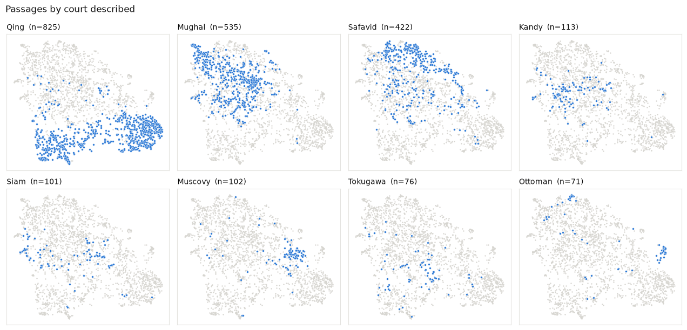

# Kings and Courts in European Eyes

A classroom lab that uses sentence embeddings to compare seventeenth-century European accounts of Asian courts, then sends students back to the texts to find out what the similarities correspond to.

[Open the browser lab](https://conradcompagna.github.io/courts-in-european-eyes/explorer/)

**Course:** European Imperialism in Asia, 1450–1850 (Online) · **Level:** upper-year undergraduate or MA; no programming experience needed · **Time:** 90-minute class plus written completion · **Format:** Jupyter notebook plus a browser explorer · **Corpus:** 2,388 passages about rulers and courts from 24 accounts in 16 EEBO-TCP books, printed in English 1625–1698



The corpus covers the Mughal, Safavid, Qing, Ayutthaya, Tokugawa and Kandyan courts, with Muscovite and Ottoman material as comparison. The observers are ambassadors (Roe, Chaumont, Nieuhof's embassy, the Holstein embassy), company servants (Hawkins, Caron, Schouten, Saris), jewel merchants (Tavernier, Chardin), a physician (Bernier), Jesuits (Le Comte), a chaplain (Terry), a captive (Knox) and adventurers (Pinto, della Valle). Sixteen of the 24 accounts reached English readers in translation.

The historiographical frame is the debate over whether European writers described distinct Asian political cultures or assimilated them to a single template of magnificence, prostration, seclusion and despotic power: Joan-Pau Rubiés, "Oriental Despotism and European Orientalism: Botero to Montesquieu", *Journal of Early Modern History* 9 (2005); Sanjay Subrahmanyam, *Courtly Encounters: Translating Courtliness and Violence in Early Modern Eurasia* (2012).

## Learning objectives

By the end of the lab students can:

1. describe how a printed book becomes a corpus of attributable passages, and audit the errors that process introduces;
2. explain what a sentence embedding and cosine similarity measure, and read a nearest-neighbour list critically;
3. separate the effect of the court described from the effect of author and translator, using nearest-neighbour agreement, a crossed comparison and a pairwise regression;
4. turn a cluster or a thematic probe into a claim that can be checked by close reading, and check it;
5. test whether a result survives a change of model or of spelling normalisation.

## Student workflow

| Stage | Task |
|---|---|
| 1 | The sources: who wrote, from what position, in which language |
| 2 | From book to passage: the five-step pipeline, and an audit of ten passages against the instructor's audit of 40 |
| 3 | What a vector notices: Roe's first audience at Ajmer (1616) and its nearest neighbours |
| 4 | The map: UMAP small multiples by court and by author |
| 5 | Court or author? Three tests |
| 6 | Clusters and close reading: label two clusters, test each label on random members |
| 7 | *(optional)* Themes across courts: ten probes, then reading and word search |
| 8 | *(optional)* Does the result survive? Raw vs normalised spelling; MiniLM vs bge |
| 9 | Memo: 400 words, one claim, one number, three quoted passages, one threat to validity |

## Browser investigation

The explorer opens with the passage map. Its cluster selector uses provisional thematic names for the ten computed groups. Clicking any dot immediately places that passage and its five closest eligible neighbours below the map; the upper-right panel shows its source metadata and a clickable list of its five nearest neighbours. Clicking empty map space clears the selection; Reset view also restores the map's original zoom and position. Draft writing remains saved. Students summarize the main content of each of the six passages in at least 100 words, then write a synthesis of at least 500 words. Neighbours may come from different clusters; the thematic names are aids to exploration, not fixed historical categories.

The neighbours are ranked by cosine similarity of MiniLM embeddings made from normalised spelling; immediately adjacent passages from the same source account are excluded to avoid repetitive context. The explorer displays the original transcription for close reading. Students ask whether similar wording points to historical practices, shared European language and genre, or both. Students enter a name or ID; **Save draft** sends even partial responses to `submissions/drafts/` in this project, and **Upload completed assignment** sends work to `submissions/completed/` after six 100-word summaries and a 500-word synthesis. Each save creates a timestamped JSON file on the instructor's server. The browser checks length, not historical reasoning. The notebook remains available for fuller quantitative analysis.

## Run it

```bash
git clone <this repository>
cd courts-in-european-eyes
python -m pip install -r requirements.txt
jupyter lab lab.ipynb
```

All vectors are included, so the notebook runs offline in under a minute. It is saved with outputs and can be read on GitHub. Only Stage 7's optional custom probe needs more: `pip install sentence-transformers`, and it downloads a model (about 90 MB) the first time.

**Explorer and central submissions.** From `courts-in-european-eyes`, run `python server.py` and open `http://127.0.0.1:8766/explorer/`. The server creates `submissions/drafts/` and `submissions/completed/` when students save. These folders are ignored by Git. For other devices on the same trusted classroom network, run `python server.py --host 0.0.0.0` and give students `http://<instructor-computer-LAN-IP>:8766/explorer/`; keep that computer and process running during class. This lightweight server has no login, so use it only on a trusted network. Opening `explorer/index.html` as a `file://` page or publishing the static page on GitHub Pages does not provide central saving. Browser storage keeps an interim copy of writing on the student's device; the buttons send the project copy to the server. EEBO-TCP source links need internet.

On the public GitHub Pages site, the submission buttons are disabled and explain why on hover. Students can still complete the reading and writing activity; their browser retains progress on that device.

## Rebuilding from the sources

```bash
python -m pip install -r requirements-rebuild.txt
python scripts/build_corpus.py        # TEI-XML -> passages (about 1 minute)
python scripts/embed.py               # 4 embedding runs (MiniLM: minutes; bge: about 15 minutes each on CPU)
python scripts/derive.py              # probes, UMAP maps, explorer data
```

## Repository

```
lab.ipynb                    student notebook (executed)
embassylab.py                every function the notebook uses, with docstrings
explorer/index.html          browser explorer; explorer/data.js is generated
explorer/investigation.js    selected passage and nearest-neighbour reading, six summaries, and synthesis
server.py                    serves the explorer and collects drafts and completed work
submissions/                central student work, created on first save and ignored by Git
data/tcp_xml/                the 16 EEBO-TCP source files (CC0)
data/sources.csv             the 24 source units and their metadata
data/passages_court.csv      the analysis corpus
data/passages_all.csv.gz     all 20,324 passages before the court filter
data/audit_sample.csv        instructor's audit of 40 passages
data/embeddings/             vectors: 2 models x 2 spellings, plus probe vectors
data/README.md               provenance, build rules, audit results, known errors
instructor/TEACHING_GUIDE.md schedule, preparation, difficulties, discussion
instructor/ANSWER_KEY.md     expected outputs and model answers
scripts/                     corpus build, embedding, derived files
```

## Technologies

Python (lxml, pandas, scikit-learn, sentence-transformers, UMAP, matplotlib), Jupyter, and a dependency-free HTML/Canvas explorer. Models: `sentence-transformers/all-MiniLM-L6-v2`, `BAAI/bge-base-en-v1.5`.

## Data and credit

Texts: Early English Books Online Text Creation Partnership, Phase I, released under CC0. See [`data/README.md`](data/README.md) for every source, the rules used to build the corpus, and its measured error rate.

Lab design and code: Conrad Compagna.
